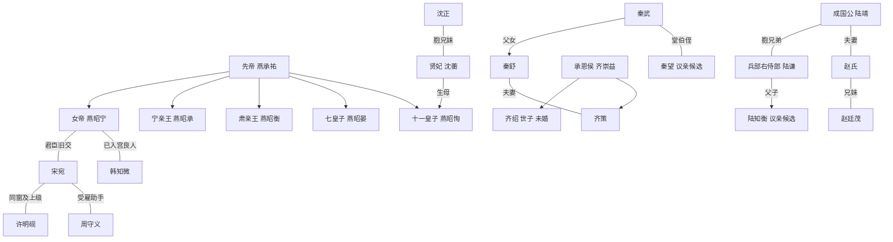

# 垂裳录人物关系定稿

本文件确定当前姓名、身份与关系；[人物背景与关联](人物背景与关联.md)记录经历、欲望、知情范围与线索。[整体大纲](整体大纲.md)记录已写进度与未来安排。尚未登场的家人可作为作者设定使用，不视为已经发生的场景。

## 一 皇室与宫廷

| 人物标识 | 姓名或身份 | 确定关系 | 后续写法 |
|---|---|---|---|
| 女帝 五皇女 仁亲王 | 燕昭宁，皇室燕氏 | 先帝与正宫皇后唯一在世的嫡出子女；皇后没有儿子 | 皇女、皇子按所有皇嗣出生顺序统一排行；五皇女是第五位皇嗣 |
| 先帝 | 燕承祐，永熙帝 | 女帝及各皇子的父亲 | 已故；是否有其他未登场皇嗣不影响现有四位皇子，不随意拉来夺储 |
| 已故皇后 | 陆静徽 | 燕昭宁生母；出身河中陆氏，与成国公的京畿陆氏无近亲关系 | “膝下无子”统一解释为无嫡子，不能写成没有女儿 |
| 大皇子 | 燕昭承，宁亲王 | 生母德妃崔氏，出身临州崔氏；与女帝同父异母 | 徐荣是其政治支持者，不是舅父；无权支配其他皇子党全部行动 |
| 三皇子 | 燕昭衡，肃亲王 | 生母淑妃卢氏，出身汾州卢氏；与女帝、大皇子同父异母 | 郑善则为其一系；与大皇子是竞争者，可阶段协作 |
| 七皇子 | 燕昭晏 | 生母昭仪程氏，出身青州程氏；与前述皇嗣同父异母 | 启元元年春十八岁，新君循例封王；第7章借请行争护卫军额，联议颁诏后往青州就藩 |
| 十一皇子 | 燕昭恂 | 生母贤妃沈蘅；与女帝及其他皇子同父异母 | 亲王位、太妃尊号仍是宋宛承诺，未默认为已册封 |
| 贤妃 | 沈蘅 | 礼部尚书沈正的胞妹，十一皇子生母 | 第6章“母家沈大人”就是沈正；她与七皇子母家是宫中往来关系，不是血亲 |
| 韩六郎 | 韩知微 | 韩靖山最小的孩子；家中子女混合排行第六，有三位兄长、两位姐姐 | 已入宫；正式位分采用“良人”，纳妃、男妃为统称，不等于另有一个妃品级 |
| 韩老将军 | 韩靖山，原西陲守将 | 韩知微之父，已致仕、仍在世 | 家道清贫、军中有旧谊，但不直接掌现役营兵；第33章来信报旧肩伤复发，已请医，未求赐医，未亲登宫中 |

陆皇后与成国公同姓但分属不同郡望；不让每个同姓人物都自动进入一个宗族。宋宛按年计龄，启元二年二十六岁；其他人物不另补无剧情用途的生辰。

### 君臣与亲密关系的边界

- **燕昭宁与宋宛：**女学推动者与早期受益者，后成为长期合作的君臣。两人有共同经历、政治信任与私人关切；当前确定为君臣旧交，不预设爱情。宋宛不是女帝的养女、亲族或幼年伴读。
- **燕昭宁与韩知微：**已有婚姻身份，第33章共膳时韩说明差事侵入日常的难处，女帝纠正借韩名义催查，命奉差照御前封函、起居循常例；韩能保留不认的观察，也能先向家中问清病情而不接受赐医。私人信任开始增长，后续情感仍由相处建立。
- **宋宛与许明砚：**同批女学及同科入仕的同道，宋宛在官署中任用、指点许明砚。可称女学同窗、官署上的前辈和上级，不称私塾师徒，不确定恋爱。
- **宋宛与三位议亲候选：**第36章已与陆知衡第一次相见，双方只认见过、未定，没有约再见、许婚或许差事；齐绍、秦望仍只有公开提名与家族推动，未问得本人是否愿见。候选个人情感不能由家族态度代替。

## 二 宋家与女学关系

| 人物 | 设定 | 与宋宛的关系及作用 |
|---|---|---|
| 宋老爷 | 宋敬修，先帝朝任户部郎中，后致仕 | 宋宛生父。五皇女曾为其在户部的任用举荐；他把这种提携看作仕途便利，仍坚持家内嫡庶与性别秩序 |
| 宋家嫡母 | 顾氏，未登场的关联人物 | 宋敬修正妻，宋宛嫡母；与皇室几位妃嫔的娘家无亲缘，不预定刻薄虐待情节 |
| 宋宛生母 | 何氏，未登场的关联人物 | 宋敬修妾室；在宋宛入女学前病逝，宋宛缺乏母族支持。死因采用寻常疾病，不新增谋害阴谋 |
| 长嫡姐 | 宋娴 | 与宋宛同父异母，嫁翰林侍读陆文璟；陆家为前朝相府，夫君本人官职不等于家族门第；与陆皇后、成国公两支陆氏均无近亲关系 |
| 次嫡姐 | 宋宜 | 与宋宛同父异母，嫁户部主事顾衡；顾家为宣平侯府旁支，顾衡是嫡母顾氏的族侄，符合正文勋贵门第。第34章正式来访，兼带父亲邀秦毅同席与嫁资田核册请求；顾氏给其永宁县四十亩田，由顾家族中代管，原契本人持有，户名异尚未查定；关心妹妹也有自身难处 |
| 姜令仪 | 第35章正式出场，礼部主事，与宋宛同批入女学 | 未婚，与梁素相熟；自述母亲择一教书男子、见过两回，询问外任可否同行，尚未订亲；保留反对公开议亲的意见，愿约自愿同窗谈实际经历 |
| 梁素 | 第35章正式出场，举人未登进士榜，女学算学讲读，与宋宛同批入学 | 已婚有一女，丈夫在布铺做事、母亲帮看孩子；家人未亲登场。愿教书成家，愿课毕协作，不以左相上级关系替代旧同窗相处 |

第1章只提父亲与嫡姐，第34章宋宜正式出场。宋敬修、顾氏与顾衡在第34章由宋宜转述，未亲自露面；宋娴、陆文璟及已故何氏也未有当下出场。转述的意见不能代替本人全部立场。

女学没有另设世袭师徒门派。宋宛、许明砚与同僚是教育和任职网络，能互助也能意见不同；任用须经考核和诏令，不能只靠“宋相门生”取得官职。第35章姜令仪与梁素各有现成工作与不同选择；宋宛承认错疑她们的关心，约听自愿同窗经历，不构成新任用。她们未获知议亲取证内情。

### 户部实差

陶敏第38章正式出场，户部主事、女学比宋宛晚数届，许赴平朔后暂承京中各州清丈汇册；与宋为上级与经办关系，不补同科、私门生或亲缘。主张先报样段、留争界与旧催单，核库收后才能判重征。两州分册与缓催获御准，地方执行未报。

## 三 老臣 宗正与清流

| 既有称呼 | 姓名与身份 | 定稿关系 |
|---|---|---|
| 温太傅 | 温廷章，先帝师傅、顾命老臣 | 与宋宛无血亲，是政治盟友；与宗正燕允礼长期共事。支持先帝遗命，保留规劝女帝与宋宛的立场 |
| 灵前盟约中的宗正 | 燕允礼，宗正寺卿，先帝叔父 | 女帝叔祖，掌宗室谱牒与册封；与温廷章是盟友，参与封存手书及灵前验诏，第30章以宗正寺卿、先帝叔父身份再定位 |
| 宗正寺少卿 | 燕允恪，宗正寺少卿 | 燕允礼的弟弟，同为女帝叔祖。反对韩氏门第，代表宗室婚姻利益；不是燕允礼突然变换立场 |
| 沈正 | 礼部尚书，贤妃胞兄 | 十一皇子的舅父。重礼法和沈家安全，主张缓进，不因为有女帝一方的亲缘就支持所有清丈措施 |
| 谢沉 | 监察御史 | 与宋宛、许明砚无亲缘，无女学师承；以协查、互相尊重形成同事关系，不预设恋情 |
| 陈珩 | 第40章正式出场，兵部郎中 | 奉御批独立核陆家一书六图，谢沉监核，陆谦不兼最终核；图件已会核封号移兵部专柜，未有结论；军款函取交另经办，不补亲缘或更高职位。 |
| 徐荣 | 礼部侍郎 | 大皇子支持者；与崔氏、齐氏、秦氏无近亲关系，靠政治取向与人情协作 |
| 郑善则 | 给事中 | 三皇子支持者；与平州郑家无宗族关系 |

沈正支持贤妃母子安全，与他在试点、纳妃章程上持保守态度并不矛盾。他可合作也可掣肘，不能简单列为沈家的唯一叛逆或女帝的绝对支持者。

## 四 京畿 勋贵与议亲三家

### 秦家与承恩侯府

- **秦武：**九门提督；幼女秦舒。
- **承恩侯：**齐崇益；长子齐绍为世子，尚未婚配；次子齐策娶秦舒。因此秦武是齐策的岳父，秦舒是齐绍的弟媳，秦武不是齐绍的岳父。
- **侯府二房：**齐崇益弟弟齐崇礼主持。二房参与边贸经营，方茂生为其管事；不因为同住侯府而默认所有晚辈知道同一批暗账。
- **秦家议亲候选：**秦望，秦武堂弟秦毅之子，故对秦武称伯父，文中可称远房侄儿。未婚，家境不如提督本房；依赖伯父的庇护但不自动被定为违法同谋。第34章宋敬修邀秦毅后日来旧宅，想请宋宛同席；宋宛未允，秦毅未亲登场，未有订婚或相看结果。
- **何副将：**何振威，秦武的军事亲信，无血缘；奉派走动与他自行添加的威胁分别核实。

### 成国公与兵部侍郎家

- **成国公：**陆靖，京畿陆氏，承袭国公爵位。
- **兵部侍郎：**陆谦，陆靖胞弟，任兵部右侍郎；议亲候选二公子是陆知衡，未婚。
- **国公夫人：**赵氏，平州赵廷茂之妹。因此赵廷茂与陆靖是姻亲，陆知衡是赵氏夫家的侄儿；不把赵氏误写成陆知衡生母。
- **两府边界：**成国公陆家与承恩侯齐家是利益可合作的两家，彼此没有直接婚姻关系，也不从属于对方。
- **陆知衡的线索边界：**第36章正式出场，未授官、读书求仕；本人坦陈结亲的家族好处与想离开父兄安排的诉求，与宋首见未定。称自己永熙二十九年依家藏刻本临六幅图，父签回函附其说明；第36章实物未见，第38章刻本一部、临图六幅已按问函交礼部封存，第40章奉御批由陈珩独立复核、谢沉监核，图件移兵部专柜、回函及原清单留礼部，结果未到。只知家里说宋管钱粮、听她问查北路，未获旧皮料和军款取证细节，不因父伯职务与正常提名定罪。

### 孙郎中与齐氏旁支

孙郎中**孙季文**，兵部职方司郎中，负责调防文牍。其母周氏，舅父之女**周素娘**嫁齐氏旁支**齐彦和**；周素娘就是原文“表妹”，齐彦和不是齐绍或齐策。以上旁支人物未直接出场，仅用于确定亲缘路径。

孙季文能准备、抄存、转递公文，不能凭一个郎中职位独立发出跨军镇调兵的最终命令。是否越权、哪些上级知情，应在查案时以签押证明。

### 九门旧卒与代领经手

| 人物 | 身份与初登 | 关系及当前事实 |
|---|---|---|
| 邱成 | 第20章先见军籍旧名，第37章本人出场；定襄籍、永熙二十二年入西营，因腿伤退营 | 秦武所辖旧卒；郑二曾替其应卯，当时点名牌已改。第37章本人亲领六两有一次伤恤批文、实拨及收票互证，不作旧饷追还；原票由谢沉收存，凭据由本人持有，妻子未名未登场。 |
| 郑二 | 第20章正式出场，西营新丁 | 曾代邱成旧名应卯，保结已齐，第37章下值亲报本人名领票落押；不补与其他郑氏同族或新的官职。 |
| 蒋兴 | 第37章首次具名、正式出场，西营原队正、仍守西门 | 秦武属下，马福旧款代领经手人；认两月各一两，首回称交马妻、次回交付人记不准。马家实收与住处须另核，补二两提议未执行，未拘押或处分；不补为所有代名新丁的共同队正。 |
| 马福 | 第37章首次见名，西营退卒，未亲出场 | 蒋兴代领合二两，无本项伤恤批文，第38章核官签述显示本人和妻子各称首回实收一两、第二回未收，余一两去向及支领应否待查；核官第37章在西门外找到马家，现住处不再仅依蒋述，不补与邱成的亲缘。 |

## 五 北境 商行与地方

| 既有标识 | 身份 | 关系与职责边界 |
|---|---|---|
| 贺帅 | 贺峥，平朔镇主帅 | 镇北任职与后来统辖整个平朔军镇不是同一任命；永熙二十一年旧货单发生时已在北境任职多年，不另限定升主帅年份 |
| 魏参将 | 魏成章，平朔军粮秣采买参将 | 贺峥部将；与商行东家贺文舟在未任现职前已有生意往来与旧交；不是何振威；第39章认经手四十石前屯改北屯、批准原牍仍欠，实际收粮已核，未定刑责 |
| 申魁 | 第39章正式出场，平朔北屯管仓军士 | 亲押本批四十石实收入仓折页、持原仓簿应核；原簿核录后归其保管，折页与交接原票随许封匣，未掌握改拨批准或全镇军款内幕。 |
| 长丰号东家 | 贺文舟 | 与贺峥不同宗，非兄弟、叔侄；同姓不连族。是否知道每笔款违法须由正文确定 |
| 长丰号掌柜 | 季同 | 贺文舟雇用的经营者，不是东家本人。散账、私账各有持有人，不能合成一人无所不知 |
| 方管事 | 方茂生，齐府二房管事 | 方守成的堂弟，负责边贸与军需货路；第29章京客是他 |
| 来宋府的侯府老管事 | 方守成，侯府大房管事 | 方茂生堂兄，熟悉礼数及两府送礼往来；第21章说客是他，不是又多出一次方茂生来访 |
| 赵老爷 | 赵廷茂，平州赵氏家主 | 成国公夫人胞兄，族中管理田产与庄丁；不提前判定盐铁案已赦或已审 |
| 赵氏族老 | 赵仲年 | 赵廷茂的叔父，第10章拄拐阻丈者；不是第15章家主本人 |
| 赵庄管家 | 石勇 | 赵氏雇用管事，非赵氏血亲；管理家丁，不由称“护院”就赋予官军身份 |
| 平河县县令 | 刘谨，平河县县令 | 平河是平州州治所在县，清丈先在该县。对赵氏依赖来自地方治理与经济关系，无血亲 |
| 郑老爷 | 郑绍安 | 平州城南田主，与郑善则无亲；选择报田是利益与安全权衡，不是效忠某皇子 |
| 林家家主 | 林修福 | 平州城北田主，与郑、赵家没有近亲关系；与郑家共同受赵氏压力，不预定相同行动 |

姓名与关系首次出场自然定位。叙述初次出现时以“魏成章，原先接待钦差的魏参将”等自然定位；熟悉场合可继续用原称呼。

## 六 情报渠道

| 人物 | 身份 | 可接触信息 | 不可拥有的权限 |
|---|---|---|---|
| 宋府查访助手 | 周守义，第11章正式出场，无官身，自由民户籍，长期受雇宋府 | 京中跑腿、商行与旧吏联系、汇总密报 | 不签官署调令，不直接率兵拘捕；自称“小的”，不称“下官” |
| 德顺旧账房 | 杜怀成，第31章正式出场，无官身，现替染坊算工钱 | 留存德顺货栈旧账，与周守义相熟；儿子在南平码头前街修船，家人未直接登场；第32章带路同兴后返家 | 只确认本人经手、记录与记忆，不掌齐府内账或北境军档 |
| 同兴老东家 | 罗长顺，第32章初登，无官身 | 与杜怀成为同行旧识；邵有田的师父，已把行中经营交给邵，保存交行时的旧簿，耳背 | 含混点头不作供证，不据店中身份掌握北路全部货事 |
| 同兴现掌事 | 邵有田，第32章初登，无官身 | 罗长顺徒弟，同兴掌事；曾押京至晋宁两车，代领齐府脚钱；与侯府是承运往来，非侯府家人 | 持齐府牌只为领脚钱，不说明雇用归属；只知本人押车与送票段，不掌北军档 |
| 太傅府老仆 | 曹慎，无官身，温府老管事 | 太傅府来往与保管事务；曾因宋宛帮助其女儿求学而愿意递消息 | 不是周守义兼任，也不持有所有宫廷密件 |
| 随队书吏眼线 | 陆平，无官身，周守义的助手 | 以犒军随行雇员身份看路线、仓外运输和经办接触；第40章随许十三日返京、交押车及换裹记录，仍无官身 | 不能冒用钦差权限搜仓；与陆氏两勋贵家无宗族关系 |
| 女帝渠道 | 御前奏报、内廷办事记录和韩知微所见 | 可与宋宛渠道交叉验证 | 不等于女帝会知道每个私人阴谋 |

周守义叙述中以姓名或明确代词称之，自称“小的”；初次身份介绍与对话中的“周老哥”等自然称呼可保留。他在京统筹，陆平赴北查访，不能混记。

## 七 一眼核对的关系图

## 八 如何维护这份定稿

用户若调整某条关系，先改本文件，再改人物档案的当前设定及相应世界资料。正文首次落实新设定时登记章号；尚未显露给读者的关系可以保留为作者背景，不安排所有人提前知道。新增血缘不能自动证明政治归属，背景姓名不能自动替代案情证据。
