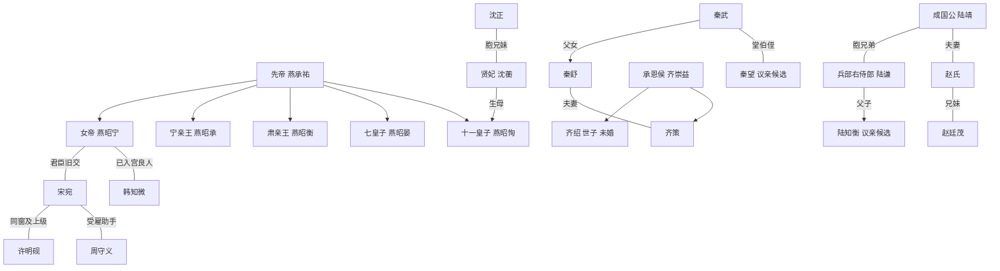

# 垂裳录人物关系定稿

本表负责固定姓名、职务及亲缘；欲望和知情见[人物档案](人物背景与关联.md)，案情与物件见[连续性表](连续性核对表.md)。尚未登场的设定不等于已发生场景。

## 一 皇室与宫廷

| 人物标识 | 姓名或身份 | 确定关系 | 后续写法 |
|---|---|---|---|
| 女帝 五皇女 仁亲王 | 燕昭宁，皇室燕氏 | 先帝与正宫皇后唯一在世的嫡出子女；皇后没有儿子 | 皇女、皇子按所有皇嗣出生顺序统一排行；五皇女是第五位皇嗣 |
| 先帝 | 燕承祐，永熙帝 | 女帝及各皇子的父亲 | 已故；是否有其他未登场皇嗣不影响现有四位皇子，不随意拉来夺储 |
| 已故皇后 | 陆静徽 | 燕昭宁生母；出身河中陆氏，与成国公的京畿陆氏无近亲关系 | “膝下无子”统一解释为无嫡子，不能写成没有女儿 |
| 大皇子 | 燕昭承，宁亲王 | 生母德妃崔氏，出身临州崔氏；与女帝同父异母 | 徐荣是其政治支持者，不是舅父；无权支配其他皇子党全部行动 |
| 三皇子 | 燕昭衡，肃亲王 | 生母淑妃卢氏，出身汾州卢氏；与女帝、大皇子同父异母 | 郑善则为其一系；与大皇子是竞争者，可阶段协作 |
| 七皇子 | 燕昭晏 | 生母昭仪程氏，出身青州程氏；与前述皇嗣同父异母 | 启元元年春十八岁，新君循例封王；第7章借请行争护卫军额，联议颁诏后往青州就藩 |
| 十一皇子 | 燕昭恂 | 沈蘅之子；与女帝及其他皇子同父异母 | 56成年亲王承诺已正式明诏，眼下未成年、未授爵，仍留京受教；未来封地另议 |
| 贤妃，56定贤太妃尊号 | 沈蘅 | 礼部尚书沈正胞妹、十一皇子生母 | 68告命承领行礼已办，原件本人持；与七母族仅宫中往来，无血亲 |
| 韩六郎 | 韩知微 | 韩靖山最小的孩子；家中子女混合排行第六，有三位兄长、两位姐姐 | 已入宫；正式位分采用“良人”，纳妃、男妃为统称，不等于另有一个妃品级 |
| 韩老将军 | 韩靖山，原西陲守将 | 韩知微之父，已致仕、仍在世 | 家道清贫、军中有旧谊，但不直接掌现役营兵；第33章来信报旧肩伤复发，已请医，未求赐医，未亲登宫中 |

陆皇后与成国公同姓但分属不同郡望；不让每个同姓人物都自动进入一个宗族。宋宛按年计龄，启元二年二十六岁；其他人物不另补无剧情用途的生辰。

### 君臣与亲密关系的边界

- **燕昭宁与宋宛：**女学推动者与早期受益者，后成为长期合作的君臣。两人有共同经历、政治信任与私人关切；当前确定为君臣旧交，不预设爱情。宋宛不是女帝的养女、亲族或幼年伴读。
- **燕昭宁与韩知微：**已婚，韩正式良人；奉差与起居分开，能保留不认的观察及个人选择，私人信任增长，感情随相处建立。
- **宋宛与许明砚：**同批女学及同科入仕的同道，宋宛在官署中任用、指点许明砚。可称女学同窗、官署上的前辈和上级，不称私塾师徒，不确定恋爱。
- **宋宛与三位议亲候选：**50本轮准停：陆暂不续，秦本人暂不应，齐愿见未约；无许婚或许官，再议须重问双方。

## 二 宋家与女学关系

| 人物 | 设定 | 与宋宛的关系及作用 |
|---|---|---|
| 宋老爷 | 宋敬修，先帝朝任户部郎中，后致仕 | 宋宛生父。五皇女曾为其在户部的任用举荐；他把这种提携看作仕途便利，仍坚持家内嫡庶与性别秩序 |
| 宋家嫡母 | 顾氏，65首次亲登 | 宋敬修正妻，宋宛嫡母；与皇室几位妃嫔的娘家无亲缘，不预定刻薄虐待情节 |
| 宋宛生母 | 何氏，未登场的关联人物 | 宋敬修妾室；在宋宛入女学前病逝，宋宛缺乏母族支持。死因采用寻常疾病，不新增谋害阴谋 |
| 长嫡姐 | 宋娴 | 与宋宛同父异母，嫁翰林侍读陆文璟；陆家为前朝相府，夫君本人官职不等于家族门第；与陆皇后、成国公两支陆氏均无近亲关系 |
| 次嫡姐 | 宋宜 | 宋宛同父异母姐，嫁户部主事顾衡；宣平侯旁支，顾衡为顾氏族侄。59永宁四十亩核名本人、更正联自持，租佃代管另行交接 |
| 姜令仪 | 35正式出场，礼部主事、未婚 | 与宋梁同批女学，不默认同科；保留批评而愿协作，49已课毕相聚 |
| 梁素 | 35正式出场，举人、女学算学讲读 | 与宋姜同批入学；已婚有女，夫在布铺、母帮照看，家人未亲登 |

顾衡42、宋敬修44、顾氏65已亲登；宋娴、陆文璟及已故何氏未亲登当下场景，转述不代本人全部立场。

女学形成教育与任职网络，无世袭师徒门派；任用经考核诏令，同批不等于同科。姜梁未获军款密报，合作不等于新授官。

### 户部实差

陶敏第38章正式出场，户部主事、女学比宋晚数届。54与谢领二十日柳林督核，69已返京交件复命、接新样册抽核；许承京中汇核，非同步出差。陶与宋为上级经办，与许为同署同僚，不补同科、私门生或亲缘。

## 三 老臣 宗正与清流

| 既有称呼 | 姓名与身份 | 定稿关系 |
|---|---|---|
| 温太傅 | 温廷章，先帝师傅、顾命老臣 | 与宋宛无血亲，是政治盟友；与宗正燕允礼长期共事。支持先帝遗命，保留规劝女帝与宋宛的立场 |
| 灵前盟约中的宗正 | 燕允礼，宗正寺卿，先帝叔父 | 女帝叔祖，掌宗室谱牒与册封；与温廷章是盟友，参与封存手书及灵前验诏，第30章以宗正寺卿、先帝叔父身份再定位 |
| 宗正寺少卿 | 燕允恪，宗正寺少卿 | 燕允礼的弟弟，同为女帝叔祖。反对韩氏门第，代表宗室婚姻利益；不是燕允礼突然变换立场 |
| 沈正 | 礼部尚书，贤妃胞兄 | 十一皇子的舅父。重礼法和沈家安全，主张缓进，不因为有女帝一方的亲缘就支持所有清丈措施 |
| 谢沉 | 监察御史 | 与宋宛、许明砚无亲缘，无女学师承；以协查、互相尊重形成同事关系，不预设恋情 |
| 陈珩 | 40正式出场，兵部郎中 | 独立核陆家图、谢监核；与陆谦是经办及持图家关系，不新增亲缘 |
| 徐荣 | 礼部侍郎 | 大皇子支持者；与崔氏、齐氏、秦氏无近亲关系，靠政治取向与人情协作 |
| 郑善则 | 给事中 | 三皇子支持者；与平州郑家无宗族关系 |

沈正支持贤妃母子安全，与他在试点、纳妃章程上持保守态度并不矛盾。他可合作也可掣肘，不能简单列为沈家的唯一叛逆或女帝的绝对支持者。

## 四 京畿 勋贵与议亲三家

### 秦家与承恩侯府

- **秦武：**九门提督；幼女秦舒。
- **承恩侯：**齐崇益；长子齐绍为世子，尚未婚配；次子齐策娶秦舒。因此秦武是齐策的岳父，秦舒是齐绍的弟媳，秦武不是齐绍的岳父。
- **侯府二房：**齐崇益弟弟齐崇礼主持。二房参与边贸经营，方茂生为其管事；不因为同住侯府而默认所有晚辈知道同一批暗账。
- **秦家议亲候选：**秦望，秦武堂弟秦毅之子，故对秦武称伯父，文中可称远房侄儿。未婚，家境不如提督本房；依赖伯父的庇护但不自动被定为违法同谋。第34章宋敬修邀秦毅后日来旧宅，想请宋宛同席；宋宛未允，秦毅未亲登场，未有订婚或相看结果。
- **何副将：**何振威，秦武军事亲信，无血缘；奉派走动与自加威胁分别核。64本项失察罚俸一月、钱粮签送暂交另人并交清，守备照行，恢复签送待复核；未证授意冯虚报。

### 成国公与兵部侍郎家

- **成国公：**陆靖，京畿陆氏，承袭国公爵位。
- **兵部侍郎：**陆谦，陆靖胞弟，任兵部右侍郎；次子陆知衡未婚。第51章陆谦亲登受件房，独立核图仍由陈珩承办。
- **国公夫人：**赵氏，平州赵廷茂之妹。因此赵廷茂与陆靖是姻亲，陆知衡是赵氏夫家的侄儿；不把赵氏误写成陆知衡生母。
- **两府边界：**成国公陆家与承恩侯齐家是利益可合作的两家，彼此没有直接婚姻关系，也不从属于对方。
- **陆知衡：**陆谦次子、陆靖侄，成年未婚未授官；求仕、想离父兄安排。36与宋首见未定，只知她管钱粮和问北路，未获军款密报。图件已按问函交核，不作定礼。

### 孙郎中与齐氏旁支

孙郎中**孙季文**，兵部职方司郎中，负责调防文牍。其母周氏，舅父之女**周素娘**嫁齐氏旁支**齐彦和**；周素娘就是原文“表妹”，齐彦和不是齐绍或齐策。以上旁支人物未直接出场，仅用于确定亲缘路径。

孙季文能准备、抄存、转递公文，不能凭一个郎中职位独立发出跨军镇调兵的最终命令。是否越权、哪些上级知情，应在查案时以签押证明。

### 九门旧卒与代领经手

| 人物 | 身份与初登 | 关系及当前事实 |
|---|---|---|
| 邱成 | 20先见旧名、37本人出场；定襄籍、永熙22年入西营，腿伤退营 | 秦所辖旧卒、蒋原队旧名；郑二曾代应卯；六两一次伤恤已核明，妻未登 |
| 郑二 | 20正式出场，西营新丁 | 曾代邱旧名，冬月改牌、现实名领票；不补其他郑氏同族关系 |
| 蒋兴 | 37具名，西营原队正，64革队正 | 秦属下、马两款各1两原代领经手；次回留用追回，64杖二十执行、三年不得经手钱粮，伤后普通营役依兵部所拟；不是全部新丁共同队正 |
| 马福 | 37见名、53本人，西营退卒 | 吴春娘之夫、住西门外赁屋；首款1两一次临济核明不追，63新恤2两由吴受托实领；不补邱亲缘，不因领恤恢复军籍 |

彭安（46初登）为营库旧经办、现西营工房记料，60核新购补料实收；冯茂（46见名、48亲登）为原西营军需书办，60杖革役已执行、三年不得充钱粮书役。两人为本项验料与誊报不同经手，无新增亲缘。刑部郎中裴行简54亲登承审，不是御史取证人。

## 五 北境 商行与地方

| 既有标识 | 身份 | 关系与职责边界 |
|---|---|---|
| 贺帅 | 贺峥，平朔镇主帅 | 镇北任职与后来统辖整个平朔军镇不是同一任命；永熙二十一年旧货单发生时已在北境任职多年，不另限定升主帅年份 |
| 魏参将 | 魏成章，平朔粮秣采买参将 | 贺部将、贺文舟未任现职前的旧交；认经手改拨，刑责未定；与何振威是两人 |
| 申魁 | 39正式出场，北屯管仓军士 | 亲押本批实收、持原仓簿，知情限本仓，不掌改拨批准及全镇军款 |
| 长丰号东家 | 贺文舟 | 与贺峥不同宗，非兄弟、叔侄；同姓不连族。是否知道每笔款违法须由正文确定 |
| 长丰号掌柜 | 季同 | 贺文舟雇用的经营者，不是东家本人。散账、私账各有持有人，不能合成一人无所不知 |
| 方管事 | 方茂生，齐府二房管事 | 方守成的堂弟，负责边贸与军需货路；第29章京客是他 |
| 来宋府的侯府老管事 | 方守成，侯府大房管事 | 方茂生堂兄，熟悉礼数及两府送礼往来；第21章说客是他，不是又多出一次方茂生来访 |
| 赵老爷 | 赵廷茂，平州赵氏家主 | 成国公夫人胞兄，族中管理田产与庄丁；不提前判定盐铁案已赦或已审 |
| 赵氏族老 | 赵仲年 | 赵廷茂的叔父，第10章拄拐阻丈者；不是第15章家主本人 |
| 赵庄管家 | 石勇 | 赵氏雇用管事，非赵氏血亲；管理家丁，不由称“护院”就赋予官军身份 |
| 平河县县令 | 刘谨，平河县县令 | 平河是平州州治所在县，清丈先在该县。对赵氏依赖来自地方治理与经济关系，无血亲 |
| 郑老爷 | 郑绍安 | 平州城南田主，与郑善则无亲；选择报田是利益与安全权衡，不是效忠某皇子 |
| 林家家主 | 林修福 | 平州城北田主，与郑、赵家没有近亲关系；与郑家共同受赵氏压力，不预定相同行动 |

姓名与关系首次出场自然定位。叙述初次出现时以“魏成章，原先接待钦差的魏参将”等自然定位；熟悉场合可继续用原称呼。

### 第51～60章新登场身份

| 姓名 | 首登及固定身份 | 关系与权限 |
|---|---|---|
| 潘成 | 52，顾族聘用庄头 | 管宋宜嫁资田代管，不是顾氏族亲；工钱和租粮分别列 |
| 方秀 | 52，永宁八亩佃户、寡居 | 家中有孩子，持与庄上原租契；与京中方管事无往来 |
| 吴春娘 | 53，马福妻 | 首款收领与第二款未收签述已核，63受托实领一次新恤2两；可代病夫回问，不掌营中批文 |
| 裴行简 | 54，刑部郎中 | 承冯茂本项审理，签送与复核责任依范围核，不自然统辖九门 |
| 程质 | 55，晋宁主簿 | 奉并州下达的御史调阅函核旧栈，非宋私仆、非知州 |
| 卢万成 | 55，通泰栈旧东家 | 栈停后为木器铺修箱，持旧簿、认自己字押，不认最后实收 |
| 邢满 | 55见名，兴和旧掌事、三年前亡 | 邢兰父，通泰北程承领押；不能安排本人再来辨押 |
| 邢兰 | 55，兴和现掌事 | 邢满女，继行；旧年在行记日用、未押此笔北程 |
| 曹尚 | 57，柳林县令 | 县中暂处置、请退税和报州查田，不能替御史判全州 |
| 刘万田 | 57，柳林返乡旧田主 | 持六亩旧契并已交本笔税，不补与平河刘谨亲缘 |
| 赵青禾 | 57，柳林安置耕户 | 与夫及孩子在县生活，夫短工、本人种两季；与平河赵族无已定关系 |

## 六 情报渠道

| 人物 | 身份 | 可接触信息 | 不可拥有的权限 |
|---|---|---|---|
| 宋府查访助手 | 周守义，第11章正式出场，无官身，自由民户籍，长期受雇宋府 | 京中跑腿、商行与旧吏联系、汇总密报 | 不签官署调令，不直接率兵拘捕；自称“小的”，不称“下官” |
| 德顺旧账房 | 杜怀成，第31章正式出场，无官身，现替染坊算工钱 | 留存德顺货栈旧账，与周守义相熟；儿子在南平码头前街修船，家人未直接登场；第32章带路同兴后返家 | 只确认本人经手、记录与记忆，不掌齐府内账或北境军档 |
| 同兴老东家 | 罗长顺，第32章初登，无官身 | 与杜怀成为同行旧识；邵有田的师父，已把行中经营交给邵，保存交行时的旧簿，耳背 | 含混点头不作供证，不据店中身份掌握北路全部货事 |
| 同兴现掌事 | 邵有田，第32章初登，无官身 | 罗长顺徒弟，同兴掌事；曾押京至晋宁两车，代领齐府脚钱；与侯府是承运往来，非侯府家人 | 持齐府牌只为领脚钱，不说明雇用归属；只知本人押车与送票段，不掌北军档 |
| 太傅府老仆 | 曹慎，无官身，温府老管事 | 太傅府来往与保管事务；曾因宋宛帮助其女儿求学而愿意递消息 | 不是周守义兼任，也不持有所有宫廷密件 |
| 随队书吏眼线 | 陆平，无官身，周助手 | 雇用押车记账，观察运输，40已随许返京 | 无钦差搜仓权；与勋贵陆氏无亲 |
| 女帝渠道 | 御前奏报、内廷办事记录和韩知微所见 | 可与宋宛渠道交叉验证 | 不等于女帝会知道每个私人阴谋 |

周守义叙述中以姓名或明确代词称之，自称“小的”；初次身份介绍与对话中的“周老哥”等自然称呼可保留。他在京统筹，陆平赴北查访，不能混记。

## 七 一眼核对的关系图

## 八 如何维护这份定稿

用户若调整某条关系，先改本文件，再改人物档案的当前设定及相应世界资料。正文首次落实新设定时登记章号；尚未显露给读者的关系可以保留为作者背景，不安排所有人提前知道。新增血缘不能自动证明政治归属，背景姓名不能自动替代案情证据。
